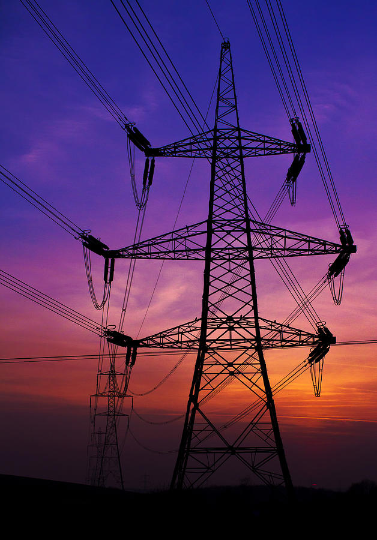
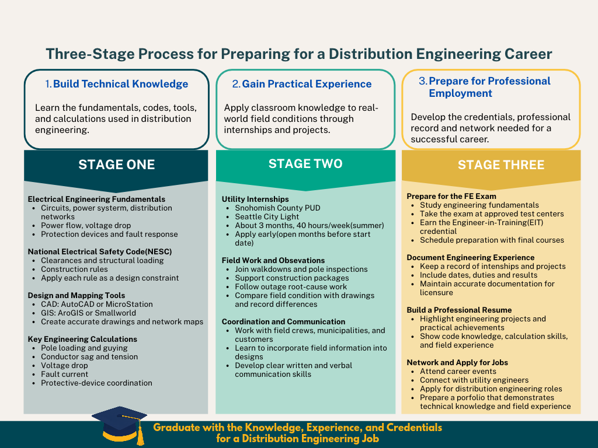

# Graduation Plan for a Career as a Distribution Engineer

Prepared for: Husky student pursuing a job as a distribution engineer

Prepared by: Candice Lyu

Date: October 27, 2026

© Image from Everything PE (everythingpe.com)

## Table of Contents

- [Purpose](#purpose)
- [Build Technical Knowledge](#build-technical-knowledge)
  - [Electrical Engineering Fundamentals](#electrical-engineering-fundamentals)
  - [Safety Codes and Design Tools](#safety-codes-and-design-tools)
  - [Engineering Calculations](#engineering-calculations)
- [Gain Practical Experience](#gain-practical-experience)
  - [Utility Internships](#utility-internships)
  - [Field Experience and Communication](#field-experience-and-communication)
- [Prepare for Professional Employment](#prepare-for-professional-employment)
  - [FE Exam Preparation](#fe-exam-preparation)
  - [Career Readiness](#career-readiness)
- [Conclusion](#conclusion)
- [References](#references)

## Purpose

Distribution engineers keep electricity flowing from substations to homes, schools, and businesses. The work blends code, calculation, and field judgment: a design must satisfy safety rules, survive a fault, and make sense to the crew that builds it. This plan lays out how you build that mix before graduation, in three stages: technical knowledge, practical experience, and professional preparation, mapped in Figure 1. This plan shows you how to graduate with the knowledge, experience, and credentials a distribution engineering job asks for.

## Build Technical Knowledge

### Electrical Engineering Fundamentals

You start with the electrical engineering fundamentals behind every distribution design: circuits, power systems, and distribution networks [5]. You learn how power flows, how voltage drops along a feeder, and how protection devices respond to faults because every design choice traces back to those behaviors.

### Safety Codes and Design Tools

You learn the National Electrical Safety Code (NESC) [1] because utilities check designs against its requirements. The NESC establishes safety requirements for clearances, structural loading, and construction. You study the code alongside your coursework and treat each rule as a constraint on real equipment and infrastructure.

You build proficiency in the tools that carry a design from planning to construction. These include computer-aided design (CAD) software, such as AutoCAD or MicroStation, engineering drawings and geographic information system (GIS) platforms, such as ArcGIS or Small world, for mapping electrical networks. Clear drawings and accurate network information help construction crews understand and implement a design.

### Engineering Calculations

You develop the calculation skills required for distribution system design, including pole loading and guying, conductor sag and tension, voltage drop, fault current, and protective-device coordination. These calculations help determine whether structures can support electrical equipment; conductors maintain safe clearances, and protective devices respond appropriately to faults. You practice these calculations and learn to explain the reasoning behind each result.

## Gain Practical Experience

### Utility Internships

You connect classroom knowledge with field conditions through internships at electric utilities. Snohomish County PUD and Seattle City Light offer college internship opportunities [2], [3]. Some summer internships last approximately three months and require 40 hours of work per week [3]. You review internship requirements and apply early because summer positions may open several months before their start dates.

### Field Experience and Communication

During an internship, you may participate in site visits, pole inspections, construction documentation, and outage investigations. Field conditions sometimes differ from engineering drawings, so you learn to document those differences and communicate them to the design team. You also gain experience coordinating with field crews, municipalities, and customers to support project implementation.

You practice explaining technical information clearly in writing and in person. Design reviews require engineers to communicate their calculations, explain design decisions, and respond to questions from colleagues and stakeholders. Strong communication skills help you support engineering decisions and collaborate effectively.

Figure 1. Graduation preparation timeline, from early fundamentals to final employment preparation.

Figure 1 maps the three stages across four phases, from early fundamentals to final employment preparation. The summer internship appears as a standalone full-time block, not stacked under a summer course load, because a 40-hour week leaves no room for full-time study. You read the timeline left to right and check each phase against the stage you stand in.

## Prepare for Professional Employment

### FE Exam Preparation

You prepare for the Fundamentals of Engineering (FE) exam [4], an important step toward obtaining a Professional Engineer (PE) license. The FE exam is offered year-round at approved testing centers. Passing the exam can help you qualify for Engineer-in-Training (EIT) status, subject to state requirements. You organize your preparation alongside your final engineering courses because the exam covers many of the fundamentals included in your degree.

### Career Readiness

You maintain records of relevant experience from internships and engineering projects, including dates, responsibilities, and results. These records help you document your technical development and may support future professional licensure applications when the experience meets applicable requirements.

You develop your resume using specific examples of engineering projects and practical experience rather than listing coursework alone. You attend career events, connect with utility engineers, and apply for distribution of engineering positions. Your portfolio demonstrates how your knowledge of safety codes, engineering calculations, design tools, and field practices prepares you for professional work.

## Conclusion

Each stage feeds the next: knowledge gives your calculations a basis, experience tests that basis in the field, and credentials turn both into a record employers trust. You graduate with more than a degree. You graduate with a plan already carried out, and the evidence to show for it.

## References

\[1] IEEE, 2023 National Electrical Safety Code (NESC), IEEE Std C2-2023. New York, NY, USA: IEEE, 2022.

\[2] Snohomish County PUD, “Careers at Snohomish County PUD – Frequently Asked Questions,” Snohomish County PUD Careers, n.d. [Online]. Available: https://careers.snopud.com/content/FAQ/?locale=en_US. [Accessed: Oct. 26, 2026].

\[3] Seattle City Light, “College Internships at Seattle City Light,” Seattle.gov, n.d. [Online]. Available: https://www.seattle.gov/city-light/about-us/careers/internships/college-internships. [Accessed: Oct. 26, 2026].

\[4] NCEES, “FE Exam,” NCEES, n.d. [Online]. Available: https://ncees.org/exams/fe-exam/. [Accessed: Oct. 26, 2026].

\[5] University of Washington Bothell, “Electrical Engineering,” UW Bothell, n.d. [Online]. Available: https://www.uwb.edu/stem/undergraduate/majors/electrical. [Accessed: Oct. 26, 2026].
[word count: 672]
